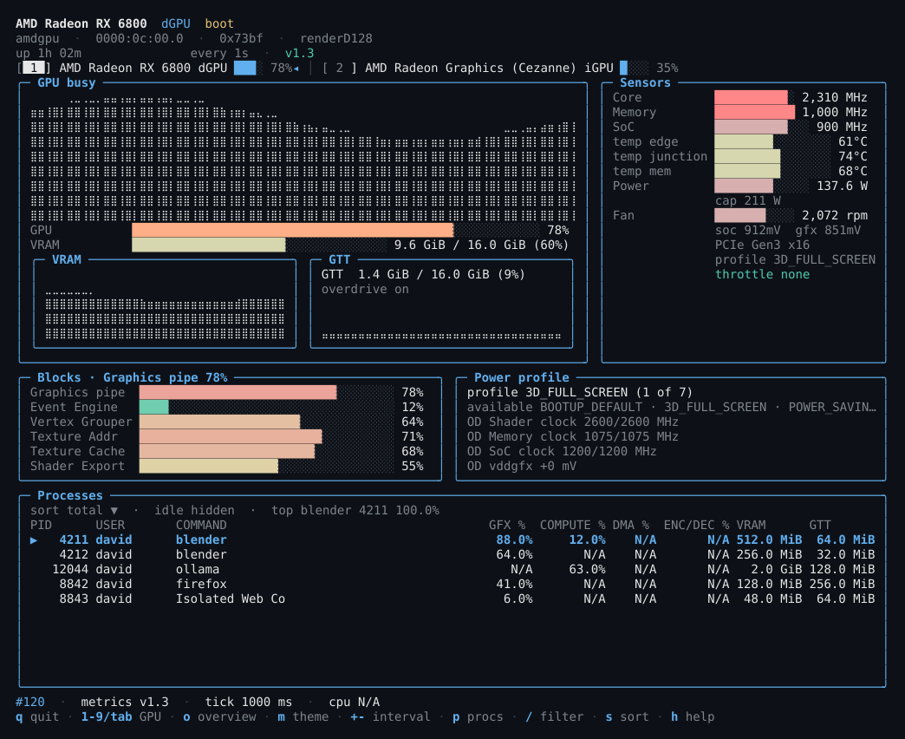
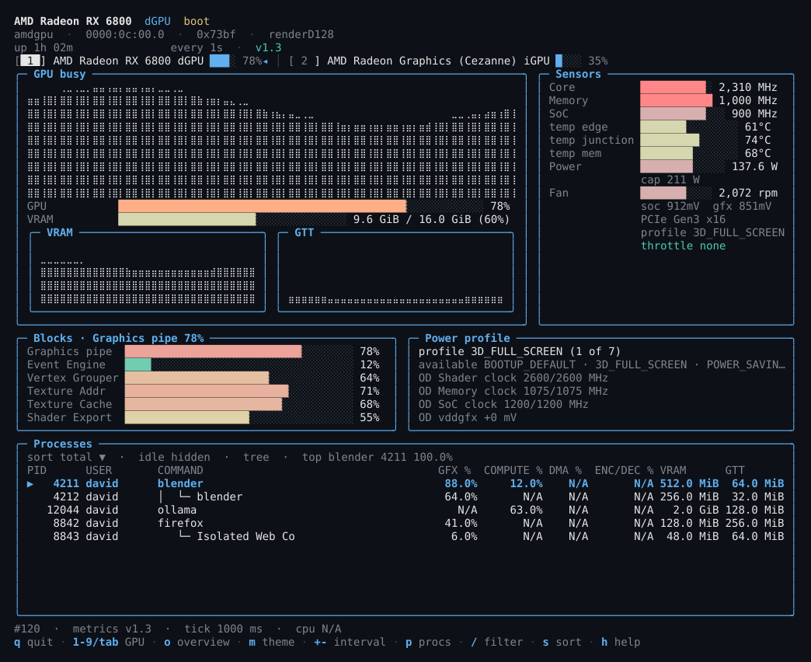
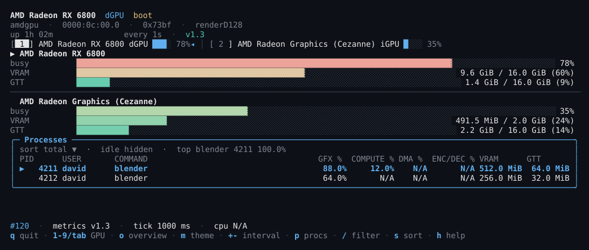
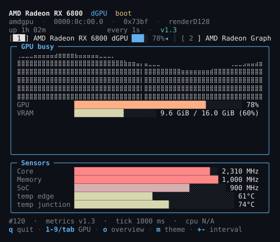
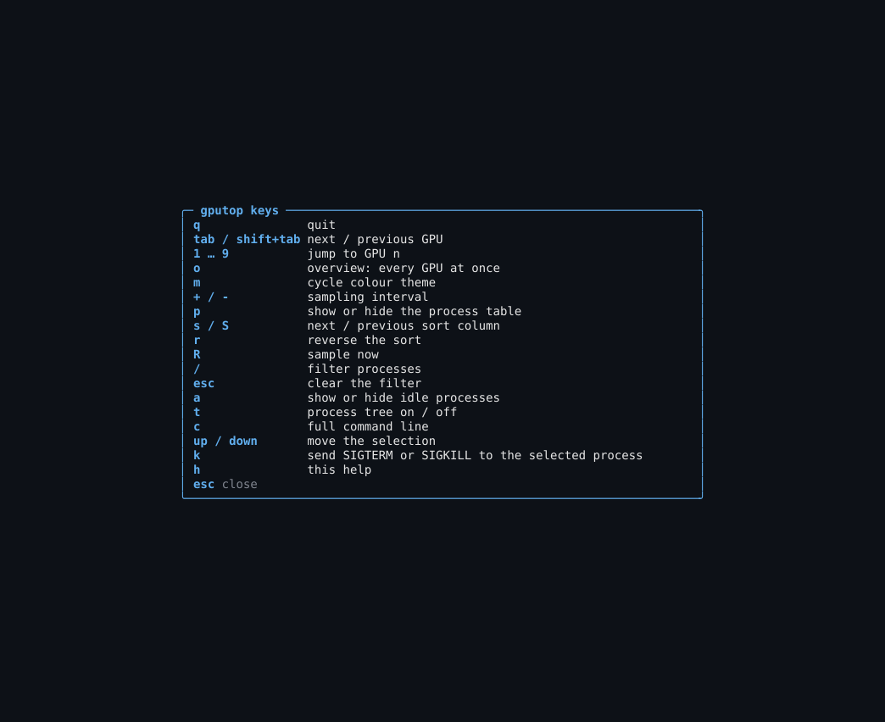

# gputop (Go)

A btop-style terminal monitor for AMD Radeon GPUs driven by the `amdgpu`
kernel driver. It reads what the kernel already publishes — utilisation,
clocks, temperatures, power against the enforced cap, throttle reasons, and
every DRM client with its per-engine time and resident memory — and it never
writes to the GPU.

This is a Go reimplementation of the Python
[gputop](https://github.com/gputop/gputop) with full v1 parity: one static
binary, no interpreter, no runtime dependencies for the user.

Everything on screen comes from files under `/sys/class/drm/card*/device/`
and `/proc/<pid>/fdinfo/`, all of them readable by an ordinary user. There is
no daemon, no setuid helper, and no write path at all: the power-profile and
overdrive tables are displayed, never set.



---

## Contents

- [Screenshots](#screenshots)
- [Install](#install)
- [Supported hardware](#supported-hardware)
- [What each panel shows](#what-each-panel-shows)
- [`gputop --check`](#gputop---check)
- [Options](#options)
- [Keys](#keys)
- [Configuration](#configuration)
- [What it reads](#what-it-reads)
- [Cost: CPU and memory](#cost-cpu-and-memory)
- [Development](#development)
- [Deployment](docs/DEPLOY.md)
- [Development with podman](docs/DEVELOPMENT.md)

---

## Screenshots

The images are generated from the same pure screen function the TUI uses, over
a deterministic synthetic machine; regenerate them with
`./scripts/podev.sh screenshots` (see
[Development with podman](docs/DEVELOPMENT.md#screenshots)).

| Process tree (`t`) | Multi-GPU overview (`o`) |
|---|---|
|  |  |

| 64-column terminal | Key reference (`h`) |
|---|---|
|  |  |

---

## Install

gputop-go ships as a **single static binary**. No interpreter, no runtime.

### From a release

Download `gputop-<version>-linux-<arch>.tar.gz` and its `.sha256`, verify the
checksum, extract it and put `gputop` on `$PATH`. The archive also carries the
man page, the three completions, the example configuration, the README with its
screenshots, the living docs and the licences.

The same artifact is built from source with podman only:

```bash
./scripts/release.sh
```

It compiles inside the Containerfile's `release` stage, copies the static
binary out of the distroless image, and writes
`dist/gputop-<version>-linux-<arch>.tar.gz` plus a `.sha256`. The host needs
no Go toolchain and nothing is installed outside `dist/`.

For checksum verification, install paths, the Arch recipe, the container
mounts and uninstall steps, see [Deploying gputop](docs/DEPLOY.md).

### Arch Linux

A `PKGBUILD` ships with the source, in `packaging/arch/PKGBUILD`:

```bash
cd packaging/arch
makepkg -si          # -s installs build dependencies, -i installs the result
```

It installs the `gputop(1)` man page, the bash, zsh and fish completions and
the licence files. The recipe builds through podman, so `podman` is the build
dependency — not a Go toolchain.

### Container image

The `release` stage is a distroless image with `/gputop` as its entrypoint:

```bash
podman build --target release -t gputop:1.1.0 .
podman run --rm -it --security-opt label=disable --pid=host \
  -v /sys:/sys:ro -v /proc:/proc:ro -v /dev/dri:/dev/dri:ro \
  gputop:1.1.0
```

The host's kernel interfaces are mounted read-only; `--pid=host` is what makes
the process table see host processes. A rootless container cannot read other
users' `fdinfo`, so the process table may be partial — `--check` says so. See
[Deploying gputop](docs/DEPLOY.md#option-3--container-image) for the measured
caveat and the headless check command.

---

## Supported hardware

gputop talks to the kernel, not to a vendor library, so "supported" means
"the driver publishes the files the panel needs" rather than a list of
marketing names.

| | |
|---|---|
| **Driver** | `amdgpu` (in-tree). A card bound to the older `radeon` driver is not visible to gputop; `gputop --check` says so. |
| **Kernel** | 5.19 or newer — the release that gave `/proc/<pid>/fdinfo` its DRM accounting keys (`drm-client-id`, `drm-engine-*`, `drm-memory-*`), the basis of the process table. |
| **`gpu_metrics`** | 5.10 or newer. Before it, the interface works from scattered sysfs attributes, one number at a time. |
| **Generations** | GCN 1–4, RDNA 1–4, and the APUs of each era. Generation-neutral paths; what appears depends on what the part publishes. |
| **Userspace** | None. gputop never opens a libdrm, Vulkan, ROCm or Mesa handle. |

What differs by generation, and what `--check` tells you on your machine:

- **Fan and extra temperatures.** Discrete cards expose `fan1_input`,
  `fan1_max` and `pwm1`; `temp2_*`/`temp3_*` are a SOC15 dGPU feature. APUs
  are passively cooled; gputop says "not on this GPU generation" rather than
  `N/A`.
- **`gpu_metrics` revision.** The file carries no version string: its
  identity is the four-byte header (`structure_size`, `format_revision`,
  `content_revision`). An unrecognised revision is never guessed at: the
  interface falls back to sysfs and names the revision in use.
- **Overdrive.** `pp_od_clk_voltage` means different things by generation.
  The panel labels what it found rather than assuming one of the three eras.
- **Power profiles.** `pp_power_profile_mode` (SCPP) exists only where the
  driver publishes it. Read-only either way.
- **HBM.** Instinct-class parts report a memory temperature a GDDR6 card does
  not have. gputop shows whichever sensors exist and invents none.

---

## What each panel shows

Nine panels, laid out to survive a narrow or short terminal (stack below 72
columns; process table yields below 20 rows; memory graphs hidden below 28;
the utilisation graph is never dropped). Panels are drawn as rounded frames,
the graph/sensor split and the VRAM/GTT pair are explicit columns, and the key
hints paint each key apart from its label.

- **Devices** — every `amdgpu` card, discrete first. `tab` / `shift+tab`
  switch, `1`–`9` jump, `o` shows every GPU at once.
- **Utilisation** — busy %, with the memory panel leading on GTT for an
  integrated GPU.
- **Sensors** — clocks, temperatures, power against the enforced cap, fan,
  throttle reasons, PCIe link width and speed.
- **Processes** — a sortable, filterable table of DRM clients (PID, USER,
  COMMAND, GFX/COMPUTE/DMA/ENC-DEC %, VRAM/GTT). Idle rows hidden unless `a`;
  sort `s`/`S`/`r`, filter `/`, tree `t`, full cmdline `c`.
- **Power profile** *(optional)* — active SCPP profile, the table it was
  chosen from, overdrive ceilings per domain. Read-only, labelled as such.
- **Blocks** *(optional, off by default)* — per-block utilisation from a
  supervised `radeontop` child. Hidden with a reason when unavailable.

---

## `gputop --check`

Reports which metrics this machine can provide and why any are missing:
kernel release vs the 5.19 floor, `gpu_metrics` ABI recognition, per-attribute
presence with the kernel release that introduced it, process-ownership
visibility (own UID vs root), and the radeontop blocks-panel state. `--json`
emits the same report as JSON. Exit status 3 when no AMD GPU is present, so
scripts can distinguish "no hardware" from "gputop is broken".

---

## Options

`gputop [-c PATH] [-i SECONDS] [--drm-root PATH] [--proc-root PATH]`
`[--dump [--pretty]] [--devices] [--kind auto|igpu|dgpu]`
`[--theme NAME] [--no-color] [--no-processes]`
`[--blocks | --no-blocks] [--log PATH] [--check [--json]] [--version]`

- `-c/--config PATH` — config file instead of the default search locations.
- `-i/--interval SECONDS` — sampling interval, overriding `interval_ms`.
- `--drm-root/--proc-root` — override sysfs DRM dir / procfs mount (testing
  and containers).
- `--dump` — one JSON snapshot to stdout and exit. `--pretty` indents it.
- `--devices` — list discovered GPUs as JSON and exit.
- `--kind auto|igpu|dgpu` — force every device to integrated/discrete.
- `--theme NAME/--no-color` — palette control (also `ui.theme` /
  `ui.no_color`, also `m`). Themes: default, dracula, gruvbox, monochrome,
  radeon.
- `--no-processes` — skip the `/proc` scan (the expensive part of a sample).
- `--blocks/--no-blocks` — force the per-block panel on/off for one run.
- `--log PATH` — record the session (`.csv`, `.json`, `.jsonl`; a trailing
  `.zst`/`.zstd` compresses). Appended, flushed per record.
- `--check [--json]` — the diagnostic report above.
- `--version` — print the version and exit.

The optional per-block panel starts `radeontop` when it is installed;
`--check` reports whether it is present.

### From a checkout (podman only — the host needs no Go toolchain)

```bash
git clone <this repo>
cd radeon-btop-go
./scripts/podev.sh build   # produces ./gputop via the container toolchain
./gputop
```

A man page is in [packaging/man/gputop.1](packaging/man/gputop.1) and
completions in [packaging/completions/](packaging/completions/).

---

## Keys

| Key | Action |
|---|---|
| `q` | quit |
| `tab` / `shift+tab` | next / previous GPU |
| `1`–`9` | jump to GPU n |
| `o` | toggle all-GPUs overview |
| `/` then text | filter processes |
| `esc` | clear filter |
| `h` / `?` | help overlay |
| `R` | resample now |
| `+` / `-` | faster / slower sampling |
| `m` | cycle theme |
| `p` | toggle process table |
| `s` / `S` / `r` | next / previous sort column, reverse direction |
| `a` | toggle idle clients |
| `t` | toggle process tree |
| `c` | toggle full command line |
| `up` / `down` | select previous / next process |
| `k` | signal selected process (needs `process.allow_kill` + confirmation) |

---

## Configuration

Precedence, lowest to highest: built-in defaults → `$GPUTOP_CONFIG` →
`~/.config/gputop/gputop.yaml` → the `state:` block gputop saved for itself →
CLI flags.

Every key is optional; unknown keys are reported as warnings and ignored, so
a file written for a newer release still works today. See
[gputop.example.yaml](gputop.example.yaml) — the key set is the same as the
Python build's, but the format is YAML, so a Python-era `.toml` file is not
read.

`state:` is written by gputop itself (theme, interval, sort, filter, view
choices) into `~/.config/gputop/config.yaml` (`$GPUTOP_STATE` overrides the
path). The write is atomic and edits the parsed document in place, so the rest
of the file — comments and key order included — is preserved.

---

## What it reads

All of it unprivileged, all of it read-only:

- `/sys/class/drm/card*/device/` — VRAM/GTT, busy %, DPM clocks, PCIe link
- `/sys/class/drm/card*/device/gpu_metrics` — versioned binary table (v1.x/v2.x)
- `/sys/class/drm/card*/device/pp_power_profile_mode` — SCPP profile table
- `/sys/class/drm/card*/device/pp_od_clk_voltage` — overdrive ceilings
- `/sys/class/hwmon/hwmon*/` — temperatures, power, fan
- `/proc/<pid>/fdinfo/` — per-process VRAM/GTT and per-engine utilisation

The one thing not read from a file is the optional blocks panel: with
`blocks.enabled` it starts `radeontop` as a child and parses its dump output.
That is the only part that can need privileges. The application never writes
to sysfs — enforced in CI by a test that parses every file in
`internal/readers` and fails on a filesystem mutator, a write-capable open, a
`Write*` method or a shell redirect (and confines process launchers to
`radeontop.go`). It works on the syntax tree, so a comment that merely mentions
writing does not trip it.

---

## Cost: CPU and memory

Measured on 2026-10-19 on an AMD Radeon RX 6800 (`amdgpu` 6.19.4, kernel
7.0.0, 24 vCPU) with the Go 1.27.2 release binary:

| | |
|---|---|
| Sampler tick, one device, sysfs only (`--no-processes`) | 3.7–4.8 ms |
| Sampler tick, 588 processes | 17–25 ms, median ≈ 20 ms |
| Sampler tick, 795–798 processes | 21–23 ms, median ≈ 22 ms |
| Start to first output, 120x40 pty | 21 ms |
| Interface CPU, 120x40, 1 s interval | 2.6 % of one core over 10 s |
| Peak RSS, 120x40 | 15.7 MiB |

The `/proc` scan dominates and is syscall-bound: one directory listing plus one
`readlink` per open descriptor. At ~800 processes the measured tick is ≈ 22 ms,
narrowly above the ~20 ms design target in SPEC §10; the sysfs-only floor is
under 5 ms. That miss is recorded as measured in PROGRESS.md rather than rounded
away. The 15.7 MiB working set is flat because history is a fixed-size ring;
a 10-second run shows the footprint, not multi-day flatness.

---

## Development

The host needs nothing but podman. All Go work runs in the container:

```bash
./scripts/podev.sh image   # (re)build the dev image (first run / after Containerfile changes)
./scripts/podev.sh build   # compile ./gputop
./scripts/podev.sh test    # go test ./...
./scripts/podev.sh vet     # go vet ./...
./scripts/podev.sh lint    # golangci-lint run ./... (set pinned in .golangci.yml)
./scripts/podev.sh fmt     # gofmt -l . (empty output == clean)
./scripts/podev.sh shell   # interactive shell in the dev image
./scripts/podev.sh run     # TUI in podman with the host's /sys, /proc, /dev/dri (read-only)
./scripts/podev.sh screenshots  # regenerate docs/screenshots/*.svg
./scripts/check_packaging.sh  # man/completions/version agree with the CLI
./scripts/release.sh       # static binary + tarball + sha256 under dist/
```

`build` writes `./gputop` into the checkout; run that binary directly when you
want the complete per-process table. `run` shares the host kernel interfaces
with the container, but a rootless user namespace hides other users' `fdinfo`
entries, so the table can be partial there — `--check` reports exactly that.
The full workflow, mounts, cache volumes and troubleshooting table are in
[Development with podman](docs/DEVELOPMENT.md).

The headless data path is covered by a **parity gate**: `internal/cli/parity_test.go`
replays the reference's `--dump` over a committed synthetic sysfs/procfs tree
and compares the two documents field for field (key order included). The tree
and golden live in `internal/cli/testdata/parity/` and are regenerated with
`scripts/parity_fixture.py` against a Python reference checkout.

Methodology gates (see AGENTS.md): TDD (red→green→refactor), MDD
(`internal/model` leads; SPEC/DESIGN/PROGRESS are the living spec), clean
code (`gofmt`+`vet`+`golangci-lint` green before every commit), Context7 for
every third-party API. `.github/workflows/ci.yml` runs all of it in the
container on every push and pull request.

See [PROGRESS.md](PROGRESS.md) for the verification ledger: what was measured
on real hardware, what was verified against fixtures, and what is still
assumed.

---

## Licence

GPL-3.0-or-later; the full text is in [LICENSE](LICENSE). This is a Go
reimplementation of the MIT-licensed Python project
[gputop](https://github.com/Chienwei82/gputop); the upstream copyright and
licence are reproduced in [NOTICE](NOTICE).
